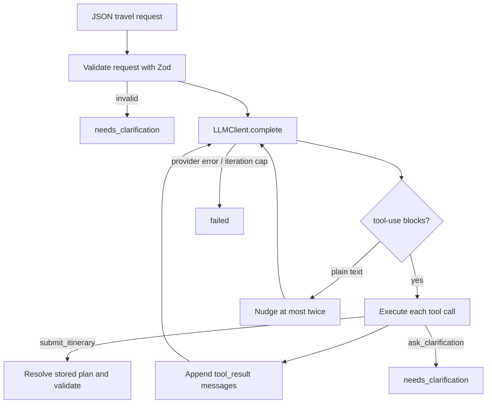

# Wayfinder Agent

A plain TypeScript CLI travel-planner agent for Lisbon, Kyoto, and Copenhagen. It uses deterministic mock travel tools and an explicit, bounded agent loop. The default LLM option is free: run Ollama locally, or use a free-tier OpenAI-compatible service such as Groq. No paid service is required.

## Architecture



`src/agent.ts` contains the provider-independent tool-calling loop. `src/llm.ts` selects the free OpenAI-compatible adapter by default or Anthropic when explicitly configured. `src/openai-compatible.ts` uses plain `fetch` and supports Ollama and compatible endpoints; `src/llm-anthropic.ts` is optional. The deterministic tools have per-run state, and the planner stores prices so the submitted itinerary cannot change totals.

## Free setup: Ollama (local)

1. Install [Ollama](https://ollama.com/download) for your computer and start it.
2. In a terminal, download the model with `ollama pull qwen2.5:7b`.
3. Install the project dependencies with `npm install`.
4. Copy `.env.example` to `.env` if you want to customize the defaults. No API key or paid service is needed for local Ollama.

Default connection settings are `LLM_BASE_URL=http://localhost:11434/v1` and `LLM_MODEL=qwen2.5:7b`.

### Free hosted alternative: Groq

Create a free developer account with [Groq](https://console.groq.com/), choose a model supported by its OpenAI-compatible API, then configure `LLM_BASE_URL=https://api.groq.com/openai/v1`, `LLM_MODEL` to the chosen model identifier, and `LLM_API_KEY` to your Groq key. Keep the key in `.env`, not in source files. Groq's free-tier limits can change.

### Optional Anthropic provider

Anthropic is not needed for this project to run. To select it, set `LLM_PROVIDER=anthropic` and configure `ANTHROPIC_API_KEY`; this is a separate, potentially paid provider.

## Commands

```sh
npm install
npm test
npm run agent -- examples/lisbon-slow.json
npm run traces
```

`npm run typecheck` is also available. The CLI prints progress lines for trace events and then prints the result JSON.

## Example inputs

- [Lisbon slow pace](examples/lisbon-slow.json)
- [Kyoto balanced pace](examples/kyoto-balanced.json)
- [Copenhagen tight budget](examples/copenhagen-tight-budget.json)
- [Unknown destination](examples/unknown-destination.json)

Inputs contain destination, inclusive trip dates, a one-traveller EUR budget, and pace/interests/dietary preferences. Trips are validated for real calendar dates and must span 2-7 days.

## Traces

Run `npm run traces` to generate JSON and Markdown trace pairs for all four examples. The generator writes provider/model metadata into each file and checks the required outcomes. Local Ollama is the default trace provider and model (`openai-compatible`, `qwen2.5:7b`); generated files record the provider/model actually used.

- [01 Lisbon slow JSON](traces/01-lisbon-slow.json) · [Markdown](traces/01-lisbon-slow.md)
- [02 Kyoto balanced JSON](traces/02-kyoto-balanced.json) · [Markdown](traces/02-kyoto-balanced.md)
- [03 Copenhagen budget replanning JSON](traces/03-copenhagen-tight-budget.json) · [Markdown](traces/03-copenhagen-tight-budget.md)
- [04 Unsupported destination clarification JSON](traces/04-unknown-destination.json) · [Markdown](traces/04-unknown-destination.md)

Runs 01 and 02 must succeed. Run 03 checks that an `over_budget` planner result appears before a successful final event; run 04 must request clarification. Trace files are generated from real model calls; do not hand-edit them.

## Tests

`npm test` uses a scripted fake LLM and mocked `fetch` tests, with no API key and no network requests. It covers tool behavior and agent control flow as well as OpenAI-compatible request/message/tool conversion, tool-call parsing, stop reasons, and sanitized HTTP errors.

## Limitations

- Travel, lodging, weather, and prices are deterministic mock data, not live availability.
- One traveller and EUR only.
- Arrival/departure times are not modeled; activity time slots are suggestions.
- Supported destinations are Lisbon, Kyoto, and Copenhagen.
- Dietary tags are mock metadata, not a guarantee about allergens or cross-contamination.
