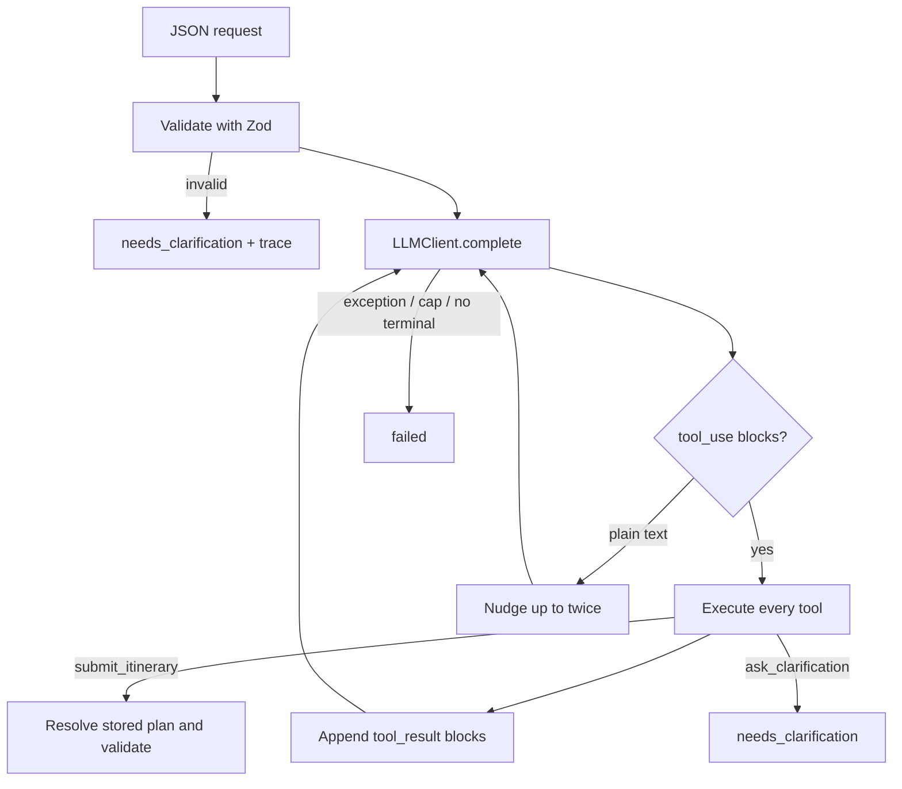

# Wayfinder Agent

A plain TypeScript CLI travel-planner agent with deterministic local travel data, an explicit injectable LLM loop, structured Zod input/output, and auditable JSON/Markdown traces. No frontend or travel API is used.

## Architecture



`src/agent.ts` owns the framework-independent, bounded loop; `src/llm-anthropic.ts` is just an adapter. Each `createToolbox()` owns isolated plan storage. The planner creates a canonical plan; submit only adds summary/tips, so model output cannot alter costs.

## Tools

| Tool | Input | Output | Possible errors |
|---|---|---|---|
| `weather_lookup` | destination, startDate, endDate | deterministic daily conditions | bad_input, no_results |
| `flight_price_lookup` | origin?, destination, dates, maxPrice? | matching saver/standard/flex options | bad_input, no_results |
| `lodging_lookup` | destination, dates, maxNightlyRate? | matching lodging options with nights/total | bad_input, no_results |
| `attractions_lookup` | destination, interests, dietary, pace?, indoorOnly? | ranked activities | bad_input, no_results |
| `calendar_day_planner` | destination, dates, budget, pace, interests, dietary, flightId, lodgingId, activityIds? | stored plan ID and estimate | bad_input, no_results, over_budget |
| `ask_clarification` | question | terminal clarification | bad_input |
| `submit_itinerary` | planId, summary, tips | stored, validated itinerary | bad_input |

All tool calls validate with Zod and return an envelope; tool errors are fed back as `is_error: true` results for replanning. The loop is bounded at 12 iterations by default and never throws.

## Setup

Requires Node 20+.

```sh
npm install
cp .env.example .env
```

Set `ANTHROPIC_API_KEY` in `.env`. The model is `claude-3-5-sonnet-latest`; override with `ANTHROPIC_MODEL`.

## Run

```sh
npm run agent -- examples/lisbon-slow.json
npm test
npm run typecheck
npm run traces
```

The CLI accepts one JSON file. Request fields: `origin` (defaults to `PRG`), `destination`, `startDate`, `endDate`, `budget` (EUR for one traveller), and `preferences` (`pace`: slow/balanced/full, `interests`: string array, `dietary`: string defaulting to none). Dates must be real YYYY-MM-DD dates and trips must be 2-7 calendar days inclusive.

### Example inputs

- [Lisbon, slow](examples/lisbon-slow.json)
- [Kyoto, balanced](examples/kyoto-balanced.json)
- [Copenhagen, tight budget](examples/copenhagen-tight-budget.json)
- [Unsupported destination](examples/unknown-destination.json)

## Error handling and replanning

The request is validated before the first model request. The agent executes every tool-use block in a turn, returns all results together, and calls the model again. Over-budget estimates include breakdown and minimumPossible; the model should lower cost or ask one concise question. Unknown destinations can be clarified. Plain-text-only turns get two nudges before the loop ends with `no_terminal_tool`.

Run 03 is intentionally configured so the first standard flight + comfort lodging plan exceeds the budget; the expected trace excerpt has the shape:

```text
calendar_day_planner -> error: over_budget (estimated > budget)
calendar_day_planner -> success after selecting lower-cost options
submit_itinerary -> final
```

This excerpt describes the expected tool flow; generated results and exact euro totals are in the trace output, not hand-authored.

## Traces

`npm run traces` calls the configured Anthropic model for all four examples and writes paired generated artifacts into `traces/`: `01-lisbon-slow`, `02-kyoto-balanced`, `03-copenhagen-tight-budget`, and `04-unknown-destination` (`.json` and `.md`). It validates the required statuses and exits nonzero when an invariant fails. Traces are never hand-edited. They are generated only when `ANTHROPIC_API_KEY` is available.

## Tests

`npm test` uses a scripted fake LLM and requires no API key. It covers tool input/errors, deterministic weather, budget enforcement, terminal plan integrity, validation before model calls, retries, clarification, iteration bounds, LLM exceptions, and plain-text nudges.

## Limitations

- Travel, weather, and prices are deterministic mock data, not live availability.
- One traveller; EUR only.
- Arrival/departure times and booking are not modeled.
- Supported destinations are Lisbon, Kyoto, and Copenhagen.
