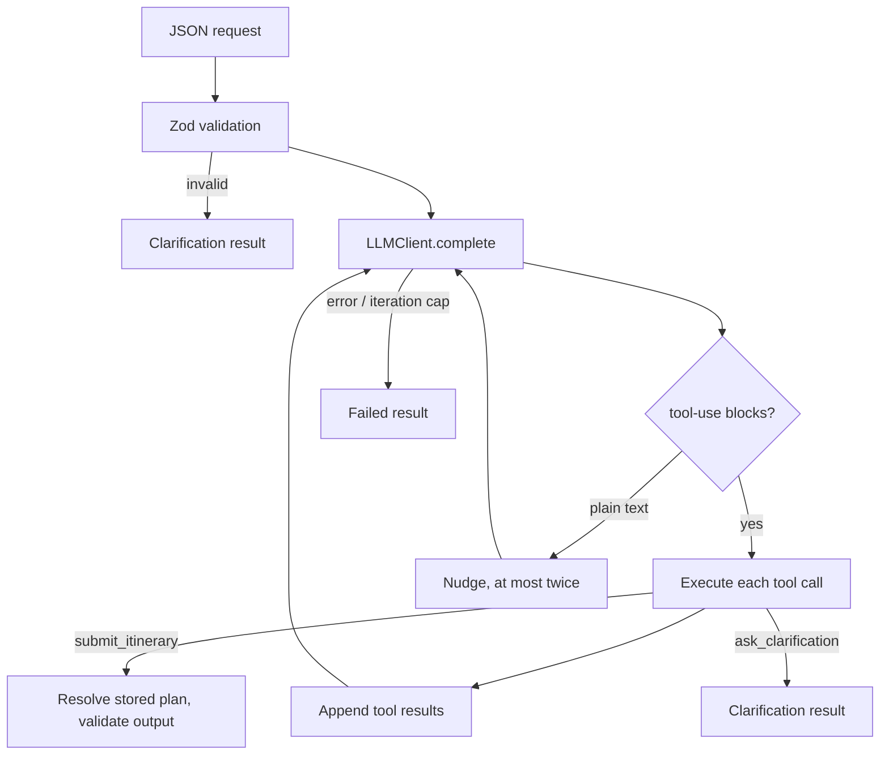

# Wayfinder Agent

A plain TypeScript CLI travel-planner agent for Lisbon, Kyoto, and Copenhagen. It validates requests, gathers deterministic mock travel data through tools, replans on tool errors, and submits a budget-checked itinerary whose prices are fixed by per-run toolbox state.

## Architecture



`src/agent.ts` contains the explicit bounded loop and depends only on the `LLMClient` interface, not an LLM framework. `src/llm-anthropic.ts` adapts the Anthropic SDK. `createToolbox()` creates per-run plan storage. `calendar_day_planner` calculates the plan and budget; `submit_itinerary` can add summary and tips but cannot change stored prices or totals.

## Tools

| Tool | Input | Output | Possible errors |
|---|---|---|---|
| `weather_lookup` | destination, startDate, endDate | deterministic forecast per date | bad_input, no_results |
| `flight_price_lookup` | origin?, destination, dates, maxPrice? | three city-specific fare tiers | bad_input, no_results |
| `lodging_lookup` | destination, dates, maxNightlyRate? | lodging options and stay totals | bad_input, no_results |
| `attractions_lookup` | destination, interests, dietary, pace?, indoorOnly? | activities ranked by interest | bad_input, no_results |
| `calendar_day_planner` | destination, dates, budget, pace, interests, dietary, flightId, lodgingId, activityIds? | stored plan ID and estimate | bad_input, no_results, over_budget |
| `ask_clarification` | question | terminal clarification | bad_input |
| `submit_itinerary` | planId, summary, tips | validated stored itinerary | bad_input |

All tools validate arguments with Zod and return a `{status: success|error}` envelope. Destination matching is case-insensitive; unsupported destinations report supported cities. Weather lookup and itinerary planning use the same deterministic forecast function. The planner ranks by interest and time of day, favors indoor activities on rain days, and filters food by realistic dietary tags.

## Setup

Requires Node.js 20 or newer.

```sh
npm install
cp .env.example .env
```

Set `ANTHROPIC_API_KEY` in `.env`. Default model: `claude-sonnet-5-5`; override it with `ANTHROPIC_MODEL`.

## Run

```sh
npm run agent -- examples/lisbon-slow.json
npm run typecheck
npm test
npm run traces
```

The CLI prints a short progress line for each trace event, then the complete result JSON. The CLI request JSON contains `origin` (defaults to `PRG`), `destination`, `startDate`, `endDate`, `budget` (EUR, one traveller), and `preferences` (`pace`: slow/balanced/full, `interests`: string array, `dietary`: string defaulting to none). Dates must be valid `YYYY-MM-DD`; trips span 2-7 inclusive calendar days.

## Example inputs

- [Lisbon, slow pace](examples/lisbon-slow.json)
- [Kyoto, balanced pace](examples/kyoto-balanced.json)
- [Copenhagen, tight budget](examples/copenhagen-tight-budget.json) (budget €620)
- [Unsupported destination](examples/unknown-destination.json)

## Error handling and replanning

Requests are validated before any LLM call. Tool errors are returned to the model as tool results, allowing it to correct bad arguments, relax constraints, or select cheaper options. Budget errors include an estimate, overage, breakdown, and minimum possible estimate. The loop is bounded to 12 iterations by default; plain-text-only replies receive two nudges before returning `no_terminal_tool`. The agent finishes with either `submit_itinerary` or `ask_clarification` when the model uses a terminal tool.

## Traces

`npm run traces` calls the configured Anthropic model for the four examples and writes paired JSON and Markdown files under `traces/`. It validates the expected run outcomes and error/replanning sequence. Trace files are generated from real model runs, not edited by hand; an API key is required.

## Tests

`npm test` uses a scripted fake LLM, so no API key is needed. It covers weather determinism, destination-specific flights, unsupported destination errors, trip-date validation, budget checks, stored-plan integrity, pace, rainy-day preferences, interest ranking, dietary filtering, clarification and success terminals, retries, iteration cap, and provider failures.

## Limitations

- Travel, weather, and prices are deterministic mock data, not live availability.
- One traveller and EUR only.
- Arrival/departure times and booking are not modeled; activity slots are suggestions.
- Supported destinations: Lisbon, Kyoto, and Copenhagen.
- Dietary tags are mock metadata, not a guarantee against allergens or cross-contamination.

## Project files

- `src/dates.ts`, `src/types.ts`: date helpers and structured schemas.
- `src/data.ts`: destination catalogs and shared deterministic weather.
- `src/tools.ts`: tools and per-run plan store.
- `src/agent.ts`: explicit injectable tool-calling loop.
- `src/llm-anthropic.ts`: Anthropic adapter.
- `src/trace.ts`: trace types and Markdown renderer.
- `src/cli.ts`: CLI entry point.
- `scripts/generate-traces.ts`: required generated trace runs.
- `tests/agent.test.ts`: tests with scripted fake LLM.
- `examples/`: sample requests.
